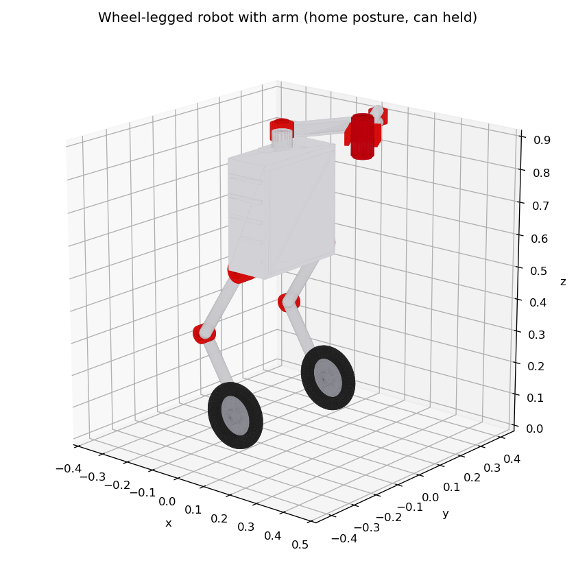
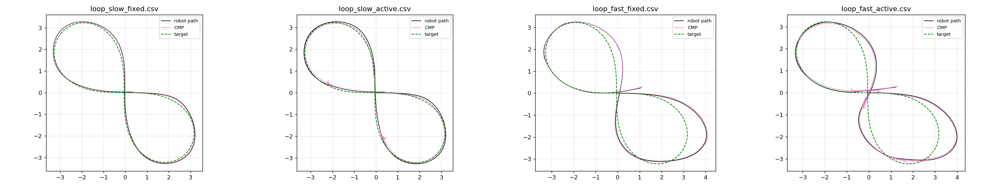

# wheel_legged_arm_balance

ROS 2 **Humble** + **Gazebo Classic 11** re-implementation of

> F. Raza, W. Zhu, M. Hayashibe, *"Balance Stability Augmentation for Wheel-Legged Biped Robot
> Through Arm Acceleration Control"*, IEEE Access, vol. 9, pp. 54022–54031, 2021.
> doi:10.1109/ACCESS.2021.3071055

The authors did not release code or CAD. Everything here, including the URDF and STL meshes, was
written from scratch using the paper. Inertial parameters come from Table 1. Values the paper
does not give were chosen and are listed under [Assumptions](#assumptions-and-deviations-from-the-paper).



## Contents

| Paper | Implementation |
|---|---|
| Fig. 1, Table 1: robot | `urdf/wheel_legged_robot.urdf.xacro`, `meshes/*.stl` (generated by `scripts/generate_meshes.py`) |
| Sec. II-A, Eqs. 1–13: lower-body model + LQR | `include/.../wip_model.hpp` (linearised model + CARE solver), `src/lqr_balance_controller.cpp` (ros2_control plugin) |
| Sec. II-B, Eqs. 14–17, Figs. 3–4: resolved acceleration arm control | `include/.../arm_dynamics.hpp`, `src/rac_arm_controller.cpp` (ros2_control plugin) |
| Sec. III, Fig. 5: finite-state machine | `src/arm_fsm_node.cpp` |
| Sec. IV, Eqs. 18–20: CMP | `src/cmp_estimator_node.cpp` (CoM / CMP / markers / integrated error) |
| Sec. V-A, Fig. 6–7, Table 2: pushes | `launch/push_experiment.launch.py`, `scripts/push_disturbance.py`, `scripts/run_push_campaign.py` |
| Sec. V-B, Fig. 8: infinity loop | `launch/infinity_loop.launch.py`, `scripts/infinity_loop_tracker.py` |
| MATLAB `lqr(A,B,Q,R)` | `scripts/compute_lqr.py` (offline); `gain_source: computed` (on-line) |
| analysis | `scripts/experiment_logger.py` (CSV + JSON), `scripts/analyze_results.py` (Table 2, Fig. 6/8 plots) |

```
gzserver ── gazebo_ros2_control (1 kHz)
              ├─ joint_state_broadcaster, imu_sensor_broadcaster
              ├─ lqr_balance_controller   (wheels, effort)   <- /lqr_balance_controller/cmd_vel (Twist)
              └─ rac_arm_controller       (arm, effort)      <- /rac_arm_controller/reference
arm_fsm_node      : /imu_sensor_broadcaster/imu + cmd_vel  -> arm reference (r_d, r_d_dot, r_d_ddot)
cmp_estimator_node: /joint_states + /ground_truth/odom (p3d) -> CoM, CMP, CMP error, RViz markers, TF world->base_link
```

## Build

Dependencies (all standard Humble debs): `gazebo_ros_pkgs gazebo_ros2_control ros2_controllers
imu_sensor_broadcaster xacro robot_state_publisher rviz2`, plus Eigen, urdfdom, python3-numpy,
python3-scipy and python3-matplotlib.

```bash
# if conda is active in your shell, leave it first (and drop ~/miniconda/bin from PATH):
# it shadows the system python that ROS uses
conda deactivate
source /opt/ros/humble/setup.bash
cd ros2_ws
colcon build --symlink-install --cmake-args -DCMAKE_BUILD_TYPE=Release
source install/setup.bash
colcon test --packages-select wheel_legged_arm_balance   # unit tests of the models (gtest)
```

## Run

```bash
# model only (RViz + joint sliders)
ros2 launch wheel_legged_arm_balance display.launch.py

# simulation: Gazebo GUI + RViz (blue sphere = CoM, pink sphere = CMP, as in Fig. 7)
ros2 launch wheel_legged_arm_balance sim.launch.py arm_mode:=active payload_mass:=0.36
#   arm_mode:=fixed        arm stays at home (baseline of the paper)
#   gain_source:=computed  K = lqr(A,B,Q,R) solved on-line instead of the paper's K
#   gui:=false rviz:=false headless
#   world:=rough           bumpy terrain (Gazebo heightmap, ~8 cm bumps)
#   world:=track           flat ground with a figure-8 road (see Experiment 2)

# drive it
ros2 run teleop_twist_keyboard teleop_twist_keyboard --ros-args -r cmd_vel:=/lqr_balance_controller/cmd_vel

# push it by hand (any time)
ros2 run wheel_legged_arm_balance push_disturbance.py --ros-args -p use_sim_time:=true -p force:=29.0 -p start_time:=0.0
```

```bash
# put the robot back at its spawn pose (e.g. after it fell) without restarting
ros2 run wheel_legged_arm_balance reset_sim.py
```

`reset_sim.py` calls `/reset_world` and clears the balance controller's integrated references
(`/lqr_balance_controller/reset`) and the CMP integral. Do **not** use `/reset_simulation`:
it rewinds the sim clock, which breaks the controllers, and the robot falls. Prefer this script
over Gazebo's *Edit → Reset* menu entries, which don't clear the controller's references.

The simulation starts **paused**. `sim_starter.py` activates all controllers and un-pauses physics
in the same step, so the inverted pendulum never runs uncontrolled. The robot spawns at its static
equilibrium pitch.

### Experiment 1: translational pushes (Sec. V-A, Table 2, Fig. 6)

```bash
# single run: 29 N push on the front of the body (-X_C) at t = 10 s for 1 s; finishes at t = 20 s
ros2 launch wheel_legged_arm_balance push_experiment.launch.py force:=29 arm_mode:=active run_name:=test
ros2 launch wheel_legged_arm_balance push_experiment.launch.py force:=29 arm_mode:=fixed  run_name:=test_fixed

# full campaign (headless): forces x can masses x {fixed, active} x repetitions -> Table 2 + Fig. 6 plots
ros2 run wheel_legged_arm_balance run_push_campaign.py --forces 27 29 31 33 --masses 0.36 0.72 --repeats 5
```

Results are written to `~/wlbr_results/` as `<run>.csv` (time series) and `<run>.json`
(time-integrated CMP error in m·s, and whether the robot fell). The campaign also writes
`table2.md` and `fig6_*.png`.

### Experiment 2: infinity loop (Sec. V-B, Fig. 8)

```bash
ros2 launch wheel_legged_arm_balance infinity_loop.launch.py arm_mode:=fixed  v_max:=0.3 w_max:=0.3 run_name:=loop_slow_fixed
ros2 launch wheel_legged_arm_balance infinity_loop.launch.py arm_mode:=active v_max:=0.3 w_max:=0.3 run_name:=loop_slow_active
ros2 launch wheel_legged_arm_balance infinity_loop.launch.py arm_mode:=fixed  v_max:=0.7 w_max:=0.6 run_name:=loop_fast_fixed
ros2 launch wheel_legged_arm_balance infinity_loop.launch.py arm_mode:=active v_max:=0.7 w_max:=0.6 run_name:=loop_fast_active
ros2 run wheel_legged_arm_balance analyze_results.py loop ~/wlbr_results/loop_*_fixed.csv ~/wlbr_results/loop_*_active.csv
```

Add `world:=track` to drive the same figure-8 on a visible road (the path is then fixed in the
world, `path_anchor:=world`), or `world:=rough` to drive it over bumpy terrain.

`analyze_results.py loop` plots the target path, the robot path and the CMP path (Fig. 8). It
also prints the mean signed lateral CMP offset towards the centre of curvature while turning.

## Reproduced results

These came from this package (Gazebo 11.10.2, 1 kHz physics, default parameters, 1 repetition
per cell, so there are no standard deviations). Raw summaries are in `docs/results/raw/`.

**Translational pushes (Table 2 equivalent)**, 1 s push at t = 10 s. e_x = ∫|CMP_x − CoM_x| dt from 5 s to 20 s:

| can mass [kg] | force [N] | fixed arm e_x [m·s] | active arm e_x [m·s] | change |
|---|---|---|---|---|
| 0.36 | 27 | 0.514 | 0.474 | −7.9 % |
| 0.36 | 29 | falls | 0.503 | — |
| 0.36 | 31 | falls | 0.550 | — |
| 0.36 | 33 | falls | falls | — |
| 0.72 | 27 | 0.497 | 0.459 | −7.6 % |
| 0.72 | 29 | 0.529 | 0.490 | −7.3 % |
| 0.72 | 31 | falls | falls | — |
| 0.72 | 33 | not run* | not run* | — |

\*The 0.72 kg / 33 N cell was lost when the campaign was interrupted (it falls at 31 N already).

- **Maximum survivable push with the 0.36 kg can:** 28 N fixed (checked separately), and 31–32 N
  with the active arm. That is about +11–14 %. The paper reports 27 → 31.5 N (+16.7 %).
- **CMP error with the active arm:** about 7–8 % lower. The paper reports 12–19 %.
- **Heavy can (0.72 kg):** the active arm still lowers the error and keeps the robot up at 29 N,
  but it does **not** extend the fall threshold beyond 31 N. In the paper, the heavier can helped
  more (32.5 N). This is not reproduced here.

**Infinity loop (Fig. 8):** `docs/fig8_infinity_loops.png`. At 0.3 m/s both modes track the
target. At 0.7 m/s both drift outward on the curves. Mean lateral CMP offset towards the centre of
curvature while turning:

| speed | fixed arm | active arm |
|---|---|---|
| 0.3 m/s, 0.3 rad/s | −0.4 cm (outside) | +6.5 cm (inside) |
| 0.7 m/s, 0.6 rad/s | −1.7 cm (outside) | +4.3 cm (inside) |

As in the paper, moving the arm towards the centre of curvature keeps the CMP inside the turn.



## Assumptions and deviations from the paper

The paper leaves several quantities unspecified. Here is what was chosen and why:

1. **Robot geometry.** Only the dynamic parameters are given (Table 1). The torso size, leg
   lengths (0.26 m), hip position and arm mount height (0.23 m above the body CoM) were chosen to
   resemble Fig. 1 and to put the body CoM `l = 0.5914 m` above the wheel axis. **The legs are
   fixed joints**, matching the paper's massless-leg assumption; their angles follow from `l`.
2. **The arm's CoM is lumped at each link's tip**, as the paper assumes (`lg1 = lg2 = 0.3`). The
   can is a separate link of 0.36 kg / 0.72 kg at the end-effector. The RAC controller adds it to
   link 2 (`payload_mass`).
3. **β is the CoM pitch.** The paper defines β as the angle between Z_R and the CoM frame
   (Fig. 2). The LQR uses the pitch of the wheel-axis→whole-body-CoM line, computed from the IMU
   plus the arm joint angles (`com_compensation: true`). Without this, the static forward offset
   of the arm and can makes the robot drift.
4. **LQR gains.** The default is the K printed in the paper (`gain_source: paper`). The on-line
   CARE solution from the same model with Q = I, R = I gives a very similar K, checked in
   `test/test_models.cpp`.
5. **"ref." in Eq. 12** is implemented as integrated position/yaw references from `cmd_vel`, plus
   a feed-forward of the wheel viscous friction `c·θ̇_rel` (`friction_feedforward`). Without the
   feed-forward, the weak yaw gains of the paper's K cannot follow 0.3 rad/s. The position and yaw
   errors are clamped (1 m / 2 rad) to avoid violent recovery after large pushes.
6. **Wheel torque limit of 4.5 Nm.** The paper does not state motor limits. Without saturation, the
   simulated robot never falls even at 80 N. 4.5 Nm was **calibrated** so that, as in the paper,
   the fixed-arm robot survives about 27–28 N but not 29 N. Change it with
   `wheel_torque_limit:=<Nm>`.
7. **The push lasts 1.0 s** (not stated in the paper). It is applied at the body CoM, along −X of
   the body, at t = 10 s, through `gazebo_ros_force_system`.
8. **FSM details.** K_x and a_th are not given. `a_th = 1.9 m/s²` corresponds to the paper's
   20 N threshold divided by the 10.3 kg total mass. `K_x = 6` was tuned. The push state has
   hysteresis (exit below 0.5·a_th), and the end-effector is held for 1 s afterwards, then returns
   home ("once [the robot] returns to its reference position the end-effector also returns to
   home"). Transitions to Right/Left use a slower 2nd-order filter (ω_n = 1.5 rad/s).
   `(α̇_ref)_TWA` uses linearly increasing weights over the last 0.5 s and is treated as 0 when
   below 0.05 rad/s.
9. **CMP metric.** The CMP is computed with Eqs. 18–20 from the whole-body CoM (URDF masses +
   ground-truth base pose). c̈ comes from a 10 Hz state-variable filter. Table 2's error is
   `∫|CMP_x − CoM_x| dt` in the robot heading frame, from t = 5 s to 20 s (m·s). The absolute
   numbers are therefore not comparable with the paper's; compare trends and percentages.
10. **Infinity loop.** The trajectory's size is not given. A Bernoulli lemniscate with a 4 m half
    width (minimum radius 1.33 m) is tracked by pure pursuit (1 m lookahead) on ground-truth
    odometry, with |ω| ≤ w_max.
11. **Gazebo specifics.** Gazebo Classic reports the IMU orientation relative to the spawn pose.
    The launch file passes the spawn orientation (`imu_reference_rpy`) to the controller and the
    FSM. URDF comments are stripped, because `gazebo_ros2_control` cannot parse them as a
    parameter. The online model database is disabled so gzserver never waits for the network.
    `gazebo_ros_force_system` needs an explicit start time (0 is not "now" in Humble).
    Gazebo Classic ignores URDF `<color>` and can only colour whole links, so the red actuators,
    wheel rims and gripper are separate massless links on fixed joints, each with a
    `<gazebo reference><material>Gazebo/…</material>`. Gazebo merges them back into their parents,
    so the physics is unchanged.

## Package layout

```
config/      controllers.yaml (LQR + RAC), arm_fsm.yaml (FSM + CMP estimator)
docs/        robot render, Fig. 8 reproduction, Table 2 results
include/     wip_model.hpp, arm_dynamics.hpp, controller headers
launch/      display, sim, push_experiment, infinity_loop
meshes/      procedurally generated STL (scripts/generate_meshes.py regenerates them)
rviz/        display.rviz, sim.rviz
scripts/     sim_starter, push_disturbance, infinity_loop_tracker, experiment_logger,
             analyze_results, run_push_campaign, compute_lqr, generate_meshes
src/         lqr_balance_controller, rac_arm_controller, arm_fsm_node, cmp_estimator_node
test/        gtest of the LQR solver / model / arm kinematics and dynamics
urdf/        wheel_legged_robot.urdf.xacro, wheel_legged_robot.ros2_control.xacro
worlds/      flat_ground.world (ODE, 1 ms), rough_terrain.world (+ heightmap png),
             figure8_track.world -- the last two are produced by scripts/generate_worlds.py
```

## Topics

| topic | type | content |
|---|---|---|
| `/lqr_balance_controller/cmd_vel` | Twist | forward / yaw velocity reference |
| `/lqr_balance_controller/state` | Float64MultiArray | p, α, β, v, α̇, β̇, τr, τl, p_ref, α_ref, v_ref, α̇_ref, body pitch, roll |
| `/rac_arm_controller/reference` | JointTrajectoryPoint | positions/velocities/accelerations = [x, y] of the end-effector in Σ_A |
| `/rac_arm_controller/state` | Float64MultiArray | x, y, ẋ, ẏ, x_ref, y_ref, ẍ_ref, ÿ_ref, τ1, τ2 |
| `/arm_fsm/state` | Float64MultiArray | state (0 home, 1 push, 2 right, 3 left, 4 hold), a_x raw, a_x filtered, TWA yaw rate, r_d, ṙ_d, r̈_d |
| `/cmp_estimator/{com,cmp}` | PointStamped | whole-body CoM and CMP (world) |
| `/cmp_estimator/cmp_error` | Vector3Stamped | CMP − CoM ground projection in the heading frame |
| `/cmp_estimator/cmp_error_integral` | Vector3Stamped | ∫\|e_x\| dt, ∫\|e_y\| dt (reset: `~/reset` service) |
| `/cmp_estimator/markers`, `~/cmp_path`, `~/base_path` | MarkerArray / Path | RViz visualisation |
